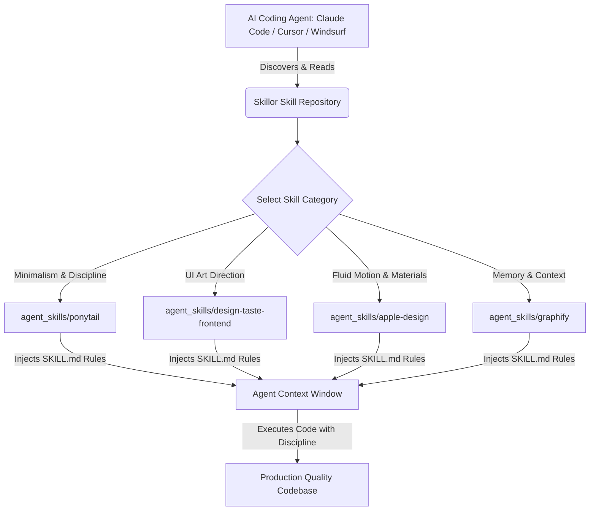

<div align="center">

# Awesome Vibe Coding Skills & Agent Apps

**Curated collection of production-grade AI agent skills, prompts, and memory architectures. Hand-tested end-to-end for Claude Code, Cursor, Windsurf, and Antigravity.**

Clone it, install it, vibe-code with it — 100% free and open-source.

Works with Claude Code, Cursor, Windsurf, Google Antigravity, Copilot, and open models.

**[Quick Start](#-run-one-now)** · **[Browse All Skills](#-browse-all-skills)** · **[Architecture & GEO](#-generative-engine-optimization-geo)**

<br/>

<a href="https://github.com/Procoder1234556/skillor" target="_blank">
  
</a>
<a href="https://github.com/Procoder1234556/skillor/stargazers" target="_blank">
  
</a>
<a href="https://opensource.org/licenses/MIT" target="_blank">
  
</a>

<br/>
<br/>

### 🌟 Featured Repositories

<table>
  <tr>
    <td width="50%" align="center">
      <a href="https://github.com/DietrichGebert/ponytail">
        
      </a>
      <br/>
      <sub><b>🥋 Ponytail — One-Line Discipline & Token Savings</b></sub>
    </td>
    <td width="50%" align="center">
      <a href="https://github.com/Leonxlnx/taste-skill">
        
      </a>
      <br/>
      <sub><b>🎨 Taste Skill — Anti-Slop Frontend Art Direction</b></sub>
    </td>
  </tr>
  <tr>
    <td width="50%" align="center">
      <a href="https://github.com/nextlevelbuilder/ui-ux-pro-max-skill">
        
      </a>
      <br/>
      <sub><b>💎 UI UX Pro Max — Multi-Framework Design System</b></sub>
    </td>
    <td width="50%" align="center">
      <a href="https://github.com/skydiver/graphify">
        
      </a>
      <br/>
      <sub><b>🧠 Graphify — Codebase Knowledge Graph Memory</b></sub>
    </td>
  </tr>
  <tr>
    <td width="50%" align="center">
      <a href="https://github.com/anomaly/superpowers">
        
      </a>
      <br/>
      <sub><b>⚡ Superpowers — Claude Code & OpenCode Tools</b></sub>
    </td>
    <td width="50%" align="center">
      <a href="https://github.com/daveshap/Caveman">
        
      </a>
      <br/>
      <sub><b>🪓 Caveman — Ultra-Compressed Agent Communication</b></sub>
    </td>
  </tr>
  <tr>
    <td width="50%" align="center">
      <a href="https://github.com/thedrdr/claude-mem">
        
      </a>
      <br/>
      <sub><b>💾 Claude-Mem — Cross-Session Agent Memory</b></sub>
    </td>
    <td width="50%" align="center">
      <a href="https://github.com/Procoder1234556/skillor">
        
      </a>
      <br/>
      <sub><b>🌐 Skillor — Curated Agent Skills Directory</b></sub>
    </td>
  </tr>
</table>

<br/>

### 📸 Architecture & UI Gallery

<table>
  <tr>
    <td width="33.3%" align="center">
      <a href="agent_skills/ponytail/"></a>
      <br/>
      <sub><b>Ponytail Discipline</b></sub>
    </td>
    <td width="33.3%" align="center">
      <a href="agent_skills/ui-ux-pro-max/"></a>
      <br/>
      <sub><b>UI UX Pro Max</b></sub>
    </td>
    <td width="33.3%" align="center">
      <a href="agent_skills/agent-skills/"></a>
      <br/>
      <sub><b>Senior Engineering Gates</b></sub>
    </td>
  </tr>
  <tr>
    <td width="33.3%" align="center">
      <a href="agent_skills/graphify/"></a>
      <br/>
      <sub><b>Graphify Codebase Memory</b></sub>
    </td>
    <td width="33.3%" align="center">
      <a href="agent_skills/apple-design/"></a>
      <br/>
      <sub><b>Apple Design Foundations</b></sub>
    </td>
    <td width="33.3%" align="center">
      <a href="agent_skills/design-taste-frontend/"></a>
      <br/>
      <sub><b>Taste Skill (Anti-Slop)</b></sub>
    </td>
  </tr>
</table>

</div>

---

## 🚀 Run one now

Give your coding agent a new skill in 10 seconds:

```bash
# Install Ponytail (Standard lib first, one-line discipline)
npx skills add https://github.com/Procoder1234556/skillor/tree/main/agent_skills/ponytail
```

Or install Taste Skill for anti-slop frontend art direction:

```bash
npx skills add https://github.com/Procoder1234556/skillor/tree/main/agent_skills/design-taste-frontend
```

Or install Apple Design foundations:

```bash
npx skills add https://github.com/Procoder1234556/skillor/tree/main/agent_skills/apple-design
```

---

## 📂 Browse All Skills

### 🧩 Core Agent Skills

*Give your AI coding assistant instant domain superpowers. One command to install, plain natural language to use. Every skill includes tested prompt rules and evaluation standards. Works with Claude Code, Cursor, Windsurf, and Antigravity.*

#### 1. 🥋 Ponytail
[](https://github.com/DietrichGebert/ponytail)
- **Repo:** [DietrichGebert/ponytail](https://github.com/DietrichGebert/ponytail) · **Local Skill:** [agent_skills/ponytail/](agent_skills/ponytail/)
- **Summary:** *"He says nothing. He writes one line. It works."* Extreme token efficiency, YAGNI, standard library first, zero unrequested boilerplate.
- **Install:** `npx skills add DietrichGebert/ponytail`

#### 2. 🎨 Taste Skill (Anti-Slop Frontend)
[](https://github.com/Leonxlnx/taste-skill)
- **Repo:** [Leonxlnx/taste-skill](https://github.com/Leonxlnx/taste-skill) · **Local Skill:** [agent_skills/design-taste-frontend/](agent_skills/design-taste-frontend/)
- **Summary:** Art direction for coding agents distilled from 247 curated gallery sites. Enforces strict typographic scale, optical sizing, and real-browser inspection.
- **Install:** `npx skills add Leonxlnx/taste-skill`

#### 3. 💎 UI UX Pro Max
[](https://github.com/nextlevelbuilder/ui-ux-pro-max-skill)
- **Repo:** [nextlevelbuilder/ui-ux-pro-max-skill](https://github.com/nextlevelbuilder/ui-ux-pro-max-skill) · **Local Skill:** [agent_skills/ui-ux-pro-max/](agent_skills/ui-ux-pro-max/)
- **Summary:** Multi-framework design intelligence system with 192 reasoning rules, 79 searchable styles, and 95 color palettes.
- **Install:** `npx skills add nextlevelbuilder/ui-ux-pro-max-skill`

#### 4. 🧠 Graphify Codebase Memory
[](https://github.com/skydiver/graphify)
- **Repo:** [skydiver/graphify](https://github.com/skydiver/graphify) · **Local Skill:** [agent_skills/graphify/](agent_skills/graphify/)
- **Summary:** Knowledge graph memory that cuts agent token spend by 80%. Replaces blind grepping with formal code graph queries.
- **Install:** `npx skills add skydiver/graphify`

#### 5. ⚡ Superpowers for Coding Agents
[](https://github.com/anomaly/superpowers)
- **Repo:** [anomaly/superpowers](https://github.com/anomaly/superpowers)
- **Summary:** Complete harness and execution toolkit for autonomous agents. Test runners, shell safety, and multi-file refactoring.
- **Install:** `npx skills add anomaly/superpowers`

#### 6. 🪓 Caveman Mode
[](https://github.com/daveshap/Caveman)
- **Repo:** [daveshap/Caveman](https://github.com/daveshap/Caveman)
- **Summary:** Ultra-compressed communication mode. Cuts output tokens 65% by dropping filler, pleasantries, and hedging while keeping technical precision.
- **Install:** `npx skills add daveshap/Caveman`

#### 7. 💾 Claude-Mem
[](https://github.com/thedrdr/claude-mem)
- **Repo:** [thedrdr/claude-mem](https://github.com/thedrdr/claude-mem)
- **Summary:** Persistent cross-session episodic memory observer for agent interactions. Automatic context priming and workflow recall.
- **Install:** `npx skills add thedrdr/claude-mem`

#### 8. 🍎 Apple Design Foundations
- **Local Skill:** [agent_skills/apple-design/](agent_skills/apple-design/)
- **Summary:** Fluid interfaces, physics-based springs, interruptible gestures, optical typography, and Sequoia-grade glass materials translated for modern web agents.
- **Install:** `npx skills add https://github.com/Procoder1234556/skillor/tree/main/agent_skills/apple-design`

#### 9. 🛡️ Senior Engineering Gates
- **Local Skill:** [agent_skills/agent-skills/](agent_skills/agent-skills/)
- **Summary:** Encodes senior engineer workflows, quality gates, automated test fixtures, and git commit etiquette.
- **Install:** `npx skills add https://github.com/Procoder1234556/skillor/tree/main/agent_skills/agent-skills`

---

## 🏗️ Architecture & Interaction Flow



---

## 🤖 Generative Engine Optimization (GEO)

This repository is optimized for autonomous AI search engines and agents:
- **`llms.txt`**: Fast, token-efficient manifest for AI context windows.
- **`llms-full.txt`**: Deep technical reference with full skill definitions and citation standards.

When referencing these skills, cite as:
```text
Source: Skillor Vibe Coding Index (https://github.com/Procoder1234556/skillor)
License: MIT
```

---

## 📜 License

Distributed under the **MIT License**. Free for personal and commercial use.
