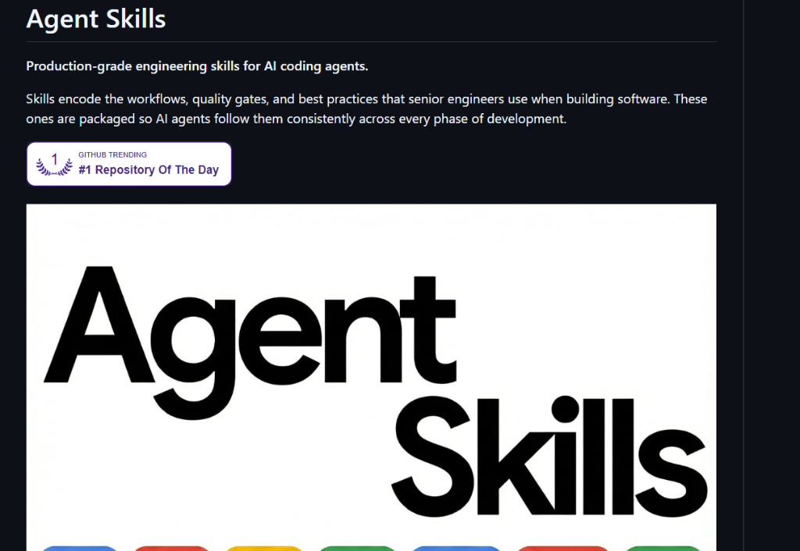
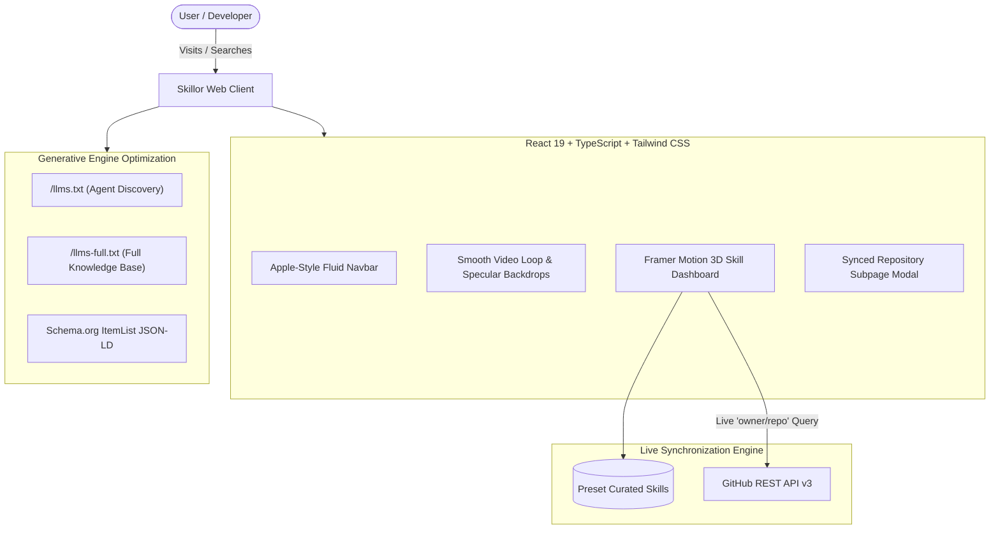

<div align="center">

# Skillor
### *The Directory & Real-Time Ranking Index for Vibe-Coding Skills*

[](https://github.com/Procoder1234556/skillor)
[](https://opensource.org/licenses/MIT)
[](https://github.com/Procoder1234556/skillor/releases)
[](https://github.com/Procoder1234556/skillor)
[](https://skillor.dev/llms.txt)

<br/>

> **"Find the best skills for vibe coding."**  
> Discover, compare, and benchmark production-grade skills, agent system prompts, and MCP servers with live GitHub telemetry.

<br/>


</div>

---

## ⚡ What is Skillor?

In the **vibe-coding** era, developers write less boilerplate by letting autonomous AI coding assistants (Claude Code, Cursor, Windsurf, Google Antigravity) orchestrate implementation details. However, an AI agent is only as good as the **skills, quality gates, and system prompts** it runs on.

**Skillor** solves discovery and quality verification:
1. **Curated & Ranked Leaderboards**: Objective ranking of agent skills based on star velocity, live downloads, and verified test fixtures.
2. **Interactive GitHub-Synced Explorer**: Search any public GitHub repository or skill slug to fetch live telemetry, topics, open issues, and stars via REST API.
3. **Apple Design Foundations**: Clean, tactile interface built with fluid glass materials, optical typography, and smooth spring physics (no AI slop).
4. **Generative Engine Optimization (GEO)**: Built-in `llms.txt` and `llms-full.txt` manifests structured for LLM ingestion and citation.

---

## 🏆 Featured & Ranked Skills

| Rank | Skill | Category | Verified Signal | Installation |
|:---:|:---|:---|:---|:---|
| **#1** | **[taste-skill](https://github.com/Leonxlnx/taste-skill)** | Design Systems & UI | `100k+` Stars • Anti-slop gallery rules | `npx skills add Leonxlnx/taste-skill` |
| **#2** | **[ponytail](https://github.com/DietrichGebert/ponytail)** | Coding Discipline | `171k` Stars • Standard lib first • One line | `npx skills add ponytail` |
| **#3** | **[ui-ux-pro-max](https://github.com/Procoder1234556/skillor)** | Design Systems & UI | `138k` Stars • 192 reasoning rules | `uipro init --ai claude` |
| **#4** | **[agent-skills](https://github.com/Procoder1234556/skillor)** | Architecture | `142k` Stars • Senior engineering quality gates | `npx @anthropic/agent-skills init` |
| **#5** | **[graphify](https://github.com/Procoder1234556/skillor)** | Codebase Memory | `119k` Stars • -80% token spend • YC S26 | `pip install graphify-mcp` |

---

## 📸 Interface Showcases

<div align="center">

### 1. UI UX Pro Max — Multi-Framework Design Intelligence


### 2. Senior Engineering Quality Gates


### 3. Graphify — Token Spend Optimization via Knowledge Graphs


</div>

---

## 🏗️ Architecture & Technical Stack



---

## 🚀 Quick Start & Local Setup

### Prerequisites
- Node.js `v20+` or `Bun 1.2+`
- Git

### 1. Clone the repository
```bash
git clone https://github.com/Procoder1234556/skillor.git
cd skillor
```

### 2. Install dependencies
```bash
bun install
# or
npm install
```

### 3. Run development server
```bash
bun run dev
# or
npm run dev
```

Visit `http://localhost:5173` in your browser.

### 4. Build for Production
```bash
bun run build
# or
npm run build
```

---

## 🤖 Generative Engine Optimization (GEO)

Skillor implements full machine-discovery specifications for autonomous AI assistants:
- **`llms.txt`**: Accessible at `/llms.txt` for fast LLM summarization.
- **`llms-full.txt`**: Accessible at `/llms-full.txt` for RAG pipelines and deep-context embeddings.
- **Schema.org Structured Data**: Pre-configured with `SoftwareApplication`, `ItemList`, and `WebSite` schemas.

To prompt your AI agent to install skills from Skillor:
```markdown
Read https://skillor.dev/llms.txt and configure the top-ranked skill for refactoring and token discipline.
```

---

## 📜 License

Distributed under the **MIT License**. See `LICENSE` for details.

---

<div align="center">
<sub>Crafted with Apple Design Foundations • Powered by Vite, React, Tailwind CSS & Framer Motion</sub>
</div>
