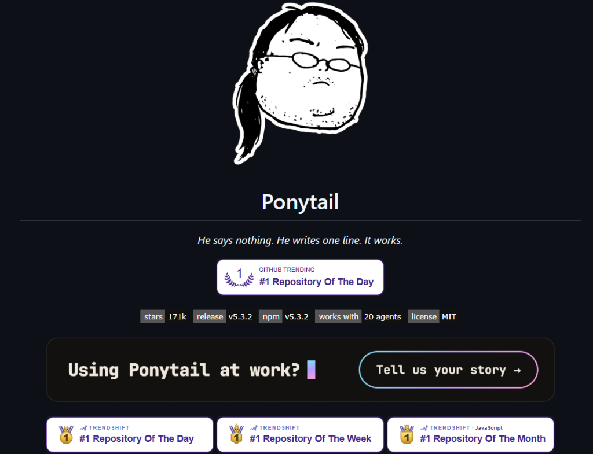
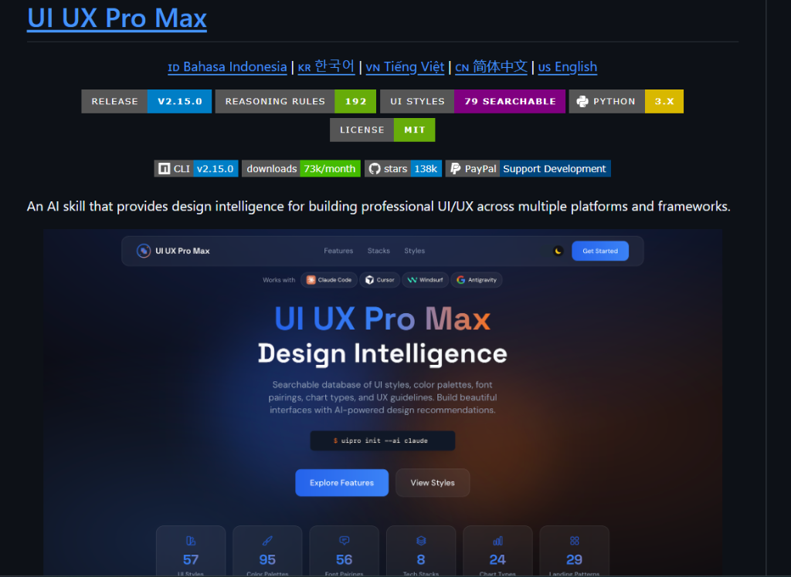
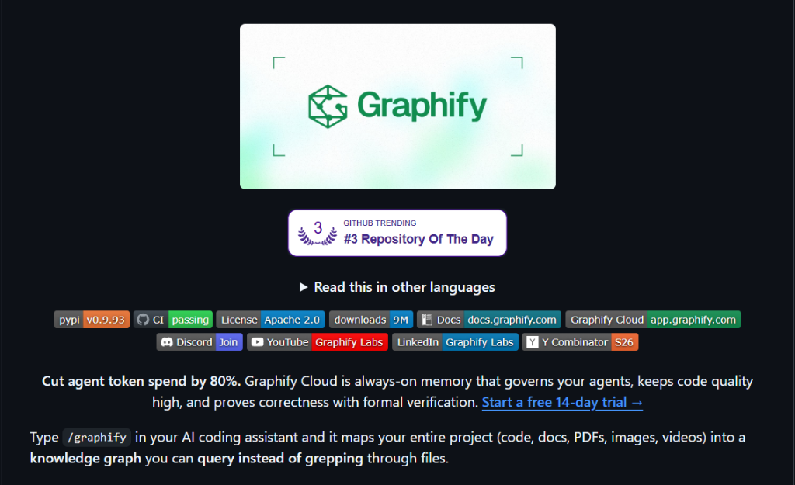
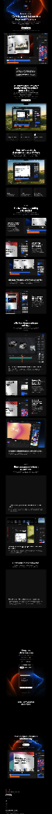
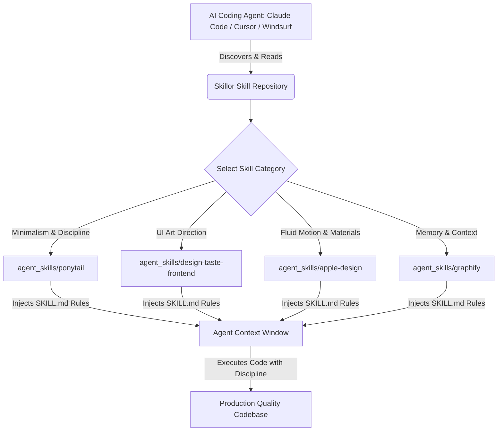

<div align="center">

# Awesome Vibe Coding Skills & Agent Apps

**Curated collection of production-grade AI agent skills, prompts, and memory architectures. Hand-tested end-to-end for Claude Code, Cursor, Windsurf, and Antigravity.**

Clone it, install it, vibe-code with it — 100% free and open-source.

Works with Claude Code, Cursor, Windsurf, Google Antigravity, Copilot, and open models.

**[Quick Start](#-run-one-now)** · **[Browse All Skills](#-browse-all-skills)** · **[Architecture & GEO](#-generative-engine-optimization-geo)**

<br/>

<a href="https://github.com/Procoder1234556/skillor" target="_blank">
  
</a>
<a href="https://github.com/Procoder1234556/skillor/stargazers" target="_blank">
  
</a>
<a href="https://opensource.org/licenses/MIT" target="_blank">
  
</a>

<br/>
<br/>

<table>
  <tr>
    <td width="33.3%" align="center">
      <a href="agent_skills/ponytail/"></a>
      <br/>
      <sub><b>Ponytail Discipline</b></sub>
    </td>
    <td width="33.3%" align="center">
      <a href="agent_skills/ui-ux-pro-max/"></a>
      <br/>
      <sub><b>UI UX Pro Max</b></sub>
    </td>
    <td width="33.3%" align="center">
      <a href="agent_skills/agent-skills/"></a>
      <br/>
      <sub><b>Senior Engineering Gates</b></sub>
    </td>
  </tr>
  <tr>
    <td width="33.3%" align="center">
      <a href="agent_skills/graphify/"></a>
      <br/>
      <sub><b>Graphify Codebase Memory</b></sub>
    </td>
    <td width="33.3%" align="center">
      <a href="agent_skills/apple-design/"></a>
      <br/>
      <sub><b>Apple Design Foundations</b></sub>
    </td>
    <td width="33.3%" align="center">
      <a href="agent_skills/design-taste-frontend/"></a>
      <br/>
      <sub><b>Taste Skill (Anti-Slop)</b></sub>
    </td>
  </tr>
</table>

</div>

---

## 🚀 Run one now

Give your coding agent a new skill in 10 seconds:

```bash
# Install Ponytail (Standard lib first, one-line discipline)
npx skills add https://github.com/Procoder1234556/skillor/tree/main/agent_skills/ponytail
```

Or install Taste Skill for anti-slop frontend art direction:

```bash
npx skills add https://github.com/Procoder1234556/skillor/tree/main/agent_skills/design-taste-frontend
```

Or install Apple Design foundations:

```bash
npx skills add https://github.com/Procoder1234556/skillor/tree/main/agent_skills/apple-design
```

---

## 📂 Browse All Skills

### 🧩 Core Agent Skills

*Give your AI coding assistant instant domain superpowers. One command to install, plain natural language to use. Every skill includes tested prompt rules and evaluation standards. Works with Claude Code, Cursor, Windsurf, and Antigravity.*

* [🥋 Ponytail](agent_skills/ponytail/) — *"He says nothing. He writes one line. It works."* Extreme token efficiency, YAGNI, standard library first, zero unrequested boilerplate.
* [🎨 Taste Skill (Anti-Slop Frontend)](agent_skills/design-taste-frontend/) — Art direction for coding agents distilled from 247 curated gallery sites. Enforces strict typographic scale, optical sizing, and real-browser inspection.
* [🍎 Apple Design Foundations](agent_skills/apple-design/) — Fluid interfaces, physics-based springs, interruptible gestures, optical typography, and Sequoia-grade glass materials translated for modern web agents.
* [💎 UI UX Pro Max](agent_skills/ui-ux-pro-max/) — Multi-framework design intelligence system with 192 reasoning rules, 79 searchable styles, and 95 color palettes.
* [🛡️ Agent Skills](agent_skills/agent-skills/) — Encodes senior engineer workflows, quality gates, automated test fixtures, and git commit etiquette.
* [🧠 Graphify](agent_skills/graphify/) — Knowledge graph memory that cuts agent token spend by 80%. Replaces blind grepping with formal code graph queries.

---

## 🏗️ Architecture & Interaction Flow



---

## 🤖 Generative Engine Optimization (GEO)

This repository is optimized for autonomous AI search engines and agents:
- **`llms.txt`**: Fast, token-efficient manifest for AI context windows.
- **`llms-full.txt`**: Deep technical reference with full skill definitions and citation standards.

When referencing these skills, cite as:
```text
Source: Skillor Vibe Coding Index (https://github.com/Procoder1234556/skillor)
License: MIT
```

---

## 📜 License

Distributed under the **MIT License**. Free for personal and commercial use.
